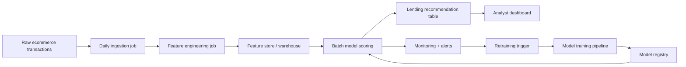
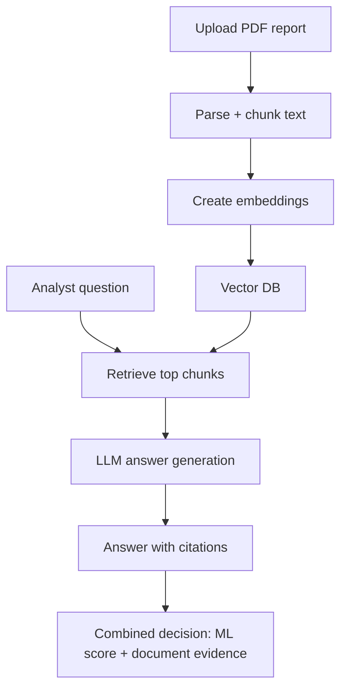

# Part 2 and Part 3 Design Notes

## Part 2: Deployment and MLOps Architecture

### Objective
Automate ingestion, feature generation, model scoring, and lending recommendation delivery.

### High-level flow

### Suggested components

- Data ingestion: API connectors + scheduled pipeline.
- Storage: Data lake for raw, warehouse for curated features/scores.
- Orchestration: Airflow or Azure Data Factory.
- Model training and registry: scikit-learn + MLflow.
- Serving/scoring: Batch job or FastAPI endpoint.
- Monitoring:
  - Data quality checks (nulls, schema, duplicates)
  - Drift checks (feature and prediction drift)
  - Model metrics tracking (AUC, precision, recall)

### Governance

- Version data + model + code together.
- Keep score decisions and overrides in audit tables.
- Use role-based access for analyst and admin users.

## Part 3: Agentic AI + RAG Extension

### Objective
Allow analysts to query uploaded PDF financial documents and combine insights with ML risk score.

### High-level flow

### Core logic

- Chunk PDF text with overlap to preserve context.
- Embed chunks and store by `case_id` / `seller_id`.
- On query, retrieve relevant chunks and build grounded prompt.
- Return answer with cited passages and confidence.
- Record all prompts/responses for audit.

### Safety and reliability controls

- Seller-level access control to avoid data leaks.
- Cite sources in every answer.
- Add confidence threshold and "not enough evidence" fallback.
- Human-in-the-loop final approval for credit decisions.
