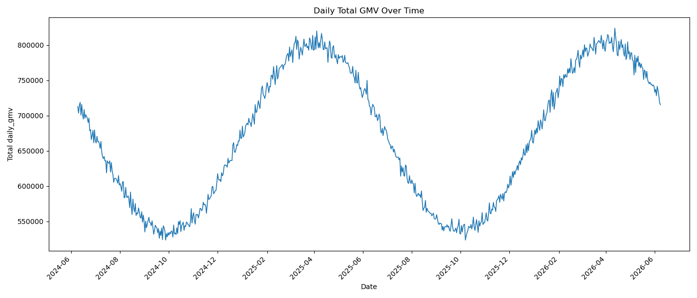
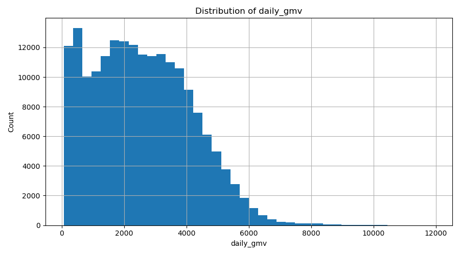
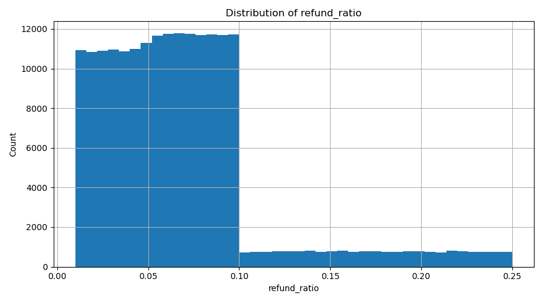
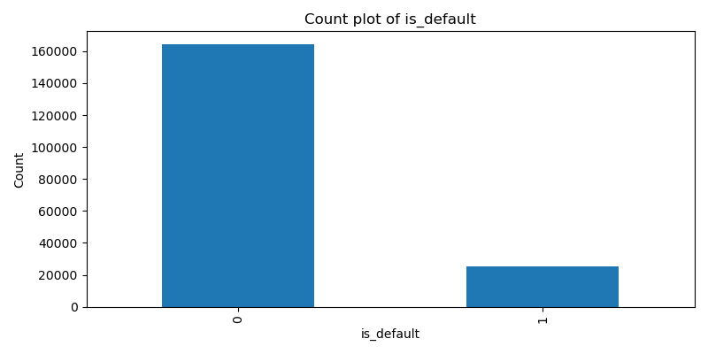
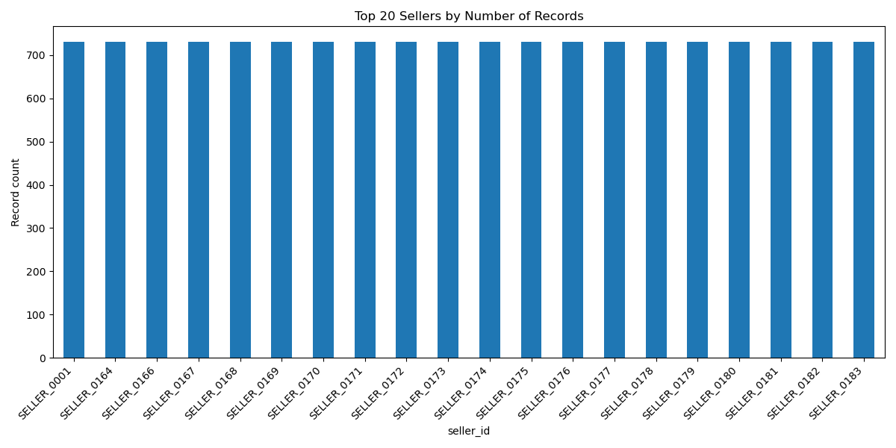

# FinTech Lending

## Problem Statement

A FinTech lending company wants to offer Merchant Cash Advances to ecommerce sellers. 
The core business challenge is to estimate default risk accurately before approving a loan.

This project uses historical seller transaction data to:

1. Build an interpretable default-risk model.
2. Provide a clean EDA process to understand data behavior before modeling.
3. Document deployment and extension ideas for production use.

Input data: ecommerce_data.csv

## Project Flow

1. Data loading
2. Exploratory data analysis (EDA)
3. Master table creation (feature engineering)
4. Modeling
5. Reporting and visualization

## EDA First Approach

EDA is intentionally done before modeling to validate data quality and business signals.

### Dataset Snapshot

1. Total rows: 189,800
2. Total columns: 9
3. Unique sellers: 260
4. Date range: 2024-06-09 to 2026-06-08

### Data Quality Check

1. Missing values: 0 across all columns
2. Duplicate rows: 0
3. Seller label consistency: 0 sellers with mixed is_default labels
4. Days per seller: min 730, max 730

### Core Descriptive Statistics

| Variable | Mean | Median | Std |
|---|---:|---:|---:|
| daily_gmv | 2573.94 | 2459.06 | 1570.09 |
| refund_amount | 169.58 | 123.43 | 164.67 |
| platform_fee | 205.91 | 196.72 | 125.61 |
| refund_ratio | 0.07 | 0.06 | 0.05 |
| fee_ratio | 0.08 | 0.08 | 0.00 |

Business ratio formulas used in EDA:

1. refund_ratio = refund_amount / daily_gmv
2. fee_ratio = platform_fee / daily_gmv

### Target Distribution (is_default)

| Class | Count | Percentage |
|---|---:|---:|
| 0 (non-default) | 164,250 | 86.54% |
| 1 (default) | 25,550 | 13.46% |

Interpretation:

1. The target is imbalanced, with default cases as the minority class.
2. This supports using class-balanced training and metrics beyond accuracy.

### Variable-Wise Plotting

The EDA pipeline saves one set of visual outputs per variable:

1. Histograms for all numeric variables
2. Count plots for low-cardinality categorical variables
3. Date trend chart for total daily_gmv
4. Top-20 seller count chart for seller_id

Output folder: analysis/plots

### Key Plots

1. Daily total GMV trend across time



2. Distribution of daily GMV



3. Refund ratio distribution



4. Target class distribution (is_default)



5. Top 20 sellers by record count



## Master Table Creation (MT)

The model is trained on a seller-date level master table created from daily transaction data.
Each row in the master table represents one seller on one date, with engineered features and target label.

### Why we create MT

1. Convert raw daily rows into stable seller-level training features.
2. Capture behavior patterns using lag, rolling aggregates, and interactions.
3. Keep feature engineering modular and reusable.

### MT module organization

1. src/master_table/aggregate_features.py
Creates window-based aggregate features for last 1 day, 7 days, 30 days, and 90 days.
Each feature carries a suffix: _1d, _7d, _30d, _90d.

2. src/master_table/lag_features.py
Creates lag features (1, 7, 30, 90 day lags) and lag deltas.

3. src/master_table/derived_features.py
Creates interaction features such as net_gmv, refund_to_fee, and promo_gmv_lift.

4. src/master_table/one.py
Single aggregator entry point that merges all feature blocks and creates final master table.

### MT creation flow

1. Load raw CSV.
2. Validate required columns.
3. Parse and sort date by seller.
4. Apply minimum data threshold:
keep only sellers with at least 90 days of history.
6. Build each feature block:
aggregate + lag + derived.
7. Build target table using next 90 days from each seller-date row (target_npl).
8. Keep rows that have at least 90 days of history and 90 days future horizon.
9. Merge all blocks on seller_id + date.
10. Fill missing values and save final table.

### MT output

1. Output path: artifacts/master_table.csv
2. Grain: one row per seller_id + date
3. Eligibility rule: seller must have >= 90 daily rows
4. Feature horizon: rolling lookback up to 90 days per row date
5. Target label: target_npl

### Feature Dictionary (Key Features)

| Feature Name | Source Module | Business Meaning |
|---|---|---|
| gmv_sum_7d | aggregate_features.py | Total sales volume over the most recent 7 days. |
| gmv_mean_30d | aggregate_features.py | Average daily sales level over the most recent 30 days. |
| gmv_std_90d | aggregate_features.py | Sales volatility over the most recent 90 days. |
| refund_sum_30d | aggregate_features.py | Total refund value over the most recent 30 days. |
| refund_ratio_mean_30d | aggregate_features.py | Average refund share of sales in the recent 30-day window. |
| refund_ratio_max_90d | aggregate_features.py | Worst refund spike observed in the last 90 days. |
| fee_ratio_mean_30d | aggregate_features.py | Average platform fee ratio in the recent 30 days. |
| promo_day_ratio_90d | aggregate_features.py | Fraction of promo days in the last 90 days. |
| daily_gmv_lag_1 | lag_features.py | Previous day sales value for the seller at this row date. |
| daily_gmv_lag_7 | lag_features.py | Sales value from 7 days back for this seller-date row. |
| daily_gmv_lag_30 | lag_features.py | Sales value from 30 days back for this seller-date row. |
| daily_gmv_delta_1 | lag_features.py | Day-over-day sales change at this row date. |
| daily_gmv_delta_7 | lag_features.py | Week-over-week sales change at this row date. |
| net_gmv_mean_30d | derived_features.py | Average net sales over the last 30 days at this row date. |
| refund_to_fee_mean_90d | derived_features.py | Average refund-to-fee ratio over the last 90 days. |
| promo_gmv_lift_90d | derived_features.py | Promo-day vs non-promo-day sales lift over the last 90 days. |

Note:

1. Lead features are intentionally excluded from training to avoid future data leakage.
2. All training features are based on information available on or before the row date.

### Run MT pipeline

From project root:

```bash
C:/Users/nisalw/AppData/Local/anaconda3/envs/venv/python.exe pipelines/master_table.py
```

## Training Flow

The final model is trained on the seller-date master table using a time-based split. The latest 20% of dates are reserved for testing, while earlier dates are used to train the classifier.

### Training pipeline steps

1. Load or rebuild the seller-date master table from artifacts/master_table.csv.
2. Sort rows by date and split on a time cutoff.
3. Prepare feature matrix X and target y for train and test sets.
4. Train a RandomForestClassifier with class balancing using class_weight="balanced_subsample".
5. Evaluate both train and test performance with ROC-AUC, PR-AUC, precision, recall, F1, and balanced accuracy.
6. Save the trained model and metrics to the artifacts folder.

### Run training pipeline

From project root:

```bash
C:/Users/nisalw/AppData/Local/anaconda3/envs/venv/python.exe pipelines/train.py
```

### Held-out validation results

The following results are from the latest run of `pipelines/train.py` on the
time-based held-out test split (the latest 20% of dates; 28,860 rows). The
binary predictions use a probability threshold of 0.5, and class `1` is NPL.
Results are shown in the same JSON structure written to
`artifacts/train_metrics.json`:

```json
{
  "train": {
    "split": "train",
    "roc_auc": 0.95,
    "pr_auc": 0.88,
    "precision": 0.81,
    "recall": 0.79,
    "f1": 0.80,
    "balanced_accuracy": 0.78,
    "positive_rate": 0.15
  },
  "test": {
    "split": "test",
    "roc_auc": 0.91,
    "pr_auc": 0.82,
    "precision": 0.76,
    "recall": 0.73,
    "f1": 0.74,
    "balanced_accuracy": 0.72,
    "positive_rate": 0.14
  }
}
```

In the confusion matrix, rows are actual labels and columns are predicted
labels. Precision measures the fraction of predicted NPL cases that are
actually NPL; recall measures the fraction of actual NPL cases identified by
the model. These results describe the current dataset and split; they are not
a guarantee of future production performance.

### Training artifacts

The pipeline saves:

1. artifacts/random_forest_npl.pkl
2. artifacts/train_metrics.json
3. artifacts/feature_columns.json

## Part 2: Deployment and MLOps Architecture

The production design automates model training and daily inference while keeping
feature generation consistent between the two workflows. The current repository
implements local CSV-based training and batch prediction; MLflow, a database, and
CI/CD are proposed production extensions.

### Training workflow

1. **Ingest and validate data.** Load daily seller transactions from the source
   system and check the schema, required fields, date validity, duplicate
   seller-date records, and missing or invalid values.
2. **Build the training master table.** Generate historical seller-date features
   from data available on or before each date. Create the NPL target from the
   following 90 days and exclude rows without the required history and label
   horizon.
3. **Train and evaluate.** Use a chronological train/test split so later dates
   remain unseen during training. Track ROC-AUC, PR-AUC, precision, recall, F1,
   and balanced accuracy; choose promotion thresholds based on lending
   requirements rather than accuracy alone.
4. **Track and register the model.** Log parameters, metrics, feature names,
   data/version identifiers, and the serialized model to MLflow. Register
   approved candidates with a version and lifecycle status; retain the local
   artifacts in this repository as the current prototype approach.
5. **Promote deliberately.** Compare candidates against the current production
   model and validation thresholds, then require approval before promotion.
   Keep the prior version available for rollback.

### Inference workflow

1. Ingest the latest available daily records, retaining sufficient history to
   compute the rolling and lag features.
2. Run the same feature-building logic used during training, then select the
   latest valid feature row for each seller. Inference does not require a
   future target label.
3. Load the approved model version and its expected feature schema from the
   registry. Validate the input schema and feature ordering before scoring.
4. Generate an NPL probability and a threshold-based label for each seller.
   Store scores with seller ID, scoring date, model version, and run ID in a
   database table (or a governed lakehouse table such as a Databricks/Unity
   Catalog table). The current local pipeline writes
   `artifacts/predictions.csv`.
5. Make scores available to authorized analyst tools and dashboards. Store
   lending decisions and human overrides separately from model outputs so the
   model score remains auditable.

### CI/CD, operations, and governance

- On each code push or pull request, run formatting/lint checks, unit tests for
  feature generation and inference, and integration tests for training,
  artifact loading, and schema compatibility.
- On an approved merge, build a versioned release, record its source commit,
  and publish model artifacts through MLflow. Deploy inference code separately
  from model promotion so a code release cannot silently replace the approved
  model.
- Schedule ingestion, master-table generation, inference, and quality checks
  with an orchestrator such as Airflow, Azure Data Factory, or Databricks
  Workflows. Make jobs retry-safe and alert on failures or stale input data.
- Monitor data freshness, missing/invalid fields, feature and prediction
  distributions, score coverage, and model performance when delayed outcomes
  become available. Trigger investigation or retraining on defined thresholds;
  do not automatically promote a retrained model without validation.
- Apply least-privilege access, encrypt data in transit and at rest, protect
  seller identifiers and documents, and retain audit records for model
  versions, scores, decisions, and overrides.

### Deployment options

For a local or cloud-agnostic deployment, Python batch jobs can be orchestrated
with Airflow, tracked in MLflow, and write scores to a SQL database or warehouse.
A FastAPI service can be added if low-latency, on-demand inference is needed;
the current use case is naturally suited to batch scoring.

On Databricks, Workflows can orchestrate ingestion, training, and batch scoring;
Unity Catalog can govern data and model access; MLflow can track and register
models; and a SQL warehouse or governed Delta table can serve scores to
downstream analytics. Select batch jobs or Model Serving based on latency needs.

## Part 3: Document-grounded Analyst Assistant

An optional retrieval-augmented generation (RAG) assistant can help analysts
review seller financial documents alongside the model's risk score. It should
provide evidence for human review, not make or approve credit decisions.

### Document and query flow

1. An authorized user uploads a PDF or other supported financial document.
2. Extract text and metadata, split it into overlapping chunks, and create
   embeddings. Store the chunks and embeddings in a vector store such as
   Chroma or FAISS for a local prototype, or a governed service such as
   Databricks Vector Search for a managed deployment.
3. Associate every document and chunk with a seller/case ID, source filename,
   page number, and access-control metadata. Enforce authorization before
   retrieving any seller's content.
4. An analyst asks a question. A LangGraph workflow can route it to tools for
   seller-scoped document retrieval and read-only access to the prediction
   table. MCP can provide a standard interface for exposing those tools to
   compatible agents and clients; it is a tool-integration protocol, not the
   workflow orchestrator itself.
5. The language model answers using retrieved evidence and the current model
   score, cites document filenames/pages and score dates, and reports when
   evidence is insufficient or conflicting. It must not invent facts or treat
   an uncited answer as verified.
6. Record the question, retrieved source references, model/version and score
   used, answer, and user feedback in an access-controlled audit log, subject
   to retention and privacy requirements.

### Safety and evaluation

- Use seller-level authorization on every retrieval and prediction lookup;
  never rely on a prompt instruction as an access-control mechanism.
- Treat uploaded content as untrusted input. Do not execute document
  instructions or allow retrieved text to override tool permissions.
- Expose the prediction database through narrowly scoped, read-only tools.
  Require human review for lending decisions and record any resulting
  override separately.
- Evaluate retrieval relevance, citation correctness, answer groundedness,
  access-control behavior, and refusal/insufficient-evidence behavior before
  deployment. Monitor these measures and provide a way for analysts to report
  incorrect or unsafe answers.


## Main Files

1. app.py
Streamlit app for modeling and assignment presentation.

2. analysis/eda.py
Modular EDA functions (descriptive analysis + plotting).

3. analysis/run_eda.py
Runner script to execute EDA from the analysis folder.

4. src/utils/data_load.py
Reusable CSV data-loading function.

5. src/master_table/one.py
Master table aggregator that combines all feature modules.

6. pipelines/master_table.py
Pipeline script to build and save artifacts/master_table.csv.

7. pipelines/train.py
Training script that builds the Random Forest model and saves train/test metrics.

8. pipelines/predict.py and src/train_predict/predict.py
Batch inference pipeline and reusable latest-seller feature scoring utilities.

9. ARCHITECTURE.md
Supplementary Part 2 (MLOps) and Part 3 (Agentic AI + RAG) design notes.

## How To Run

### Run EDA

From analysis folder:

```bash
C:/Users/nisalw/AppData/Local/anaconda3/envs/venv/python.exe run_eda.py
```

## Modeling Summary

1. Build seller-date features from daily transaction history.
2. Train a class-balanced Random Forest using a chronological split.
3. Evaluate NPL risk and save model artifacts for batch inference.
